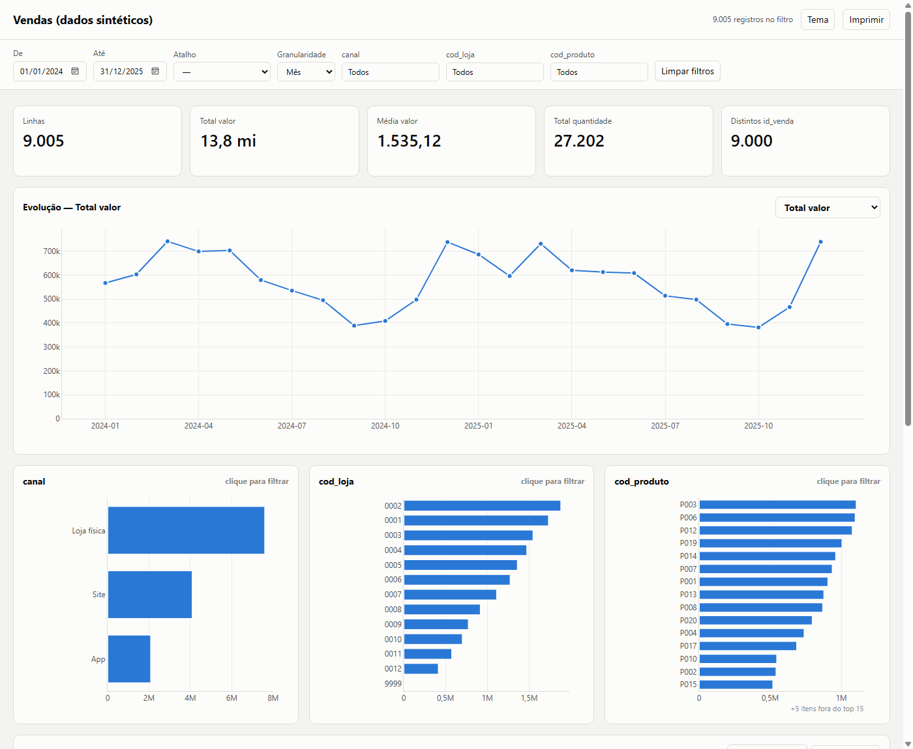

# analise-dados-skills

Skills de análise e ciência de dados em português para o **Claude Code** (e compatíveis com o **Codex**): perfil e qualidade de bases, cruzamento auditado entre planilhas e sistemas, estatística, séries temporais com previsão validada, dashboards HTML interativos para abrir no navegador e construção de modelos e relatórios no **Power BI pelo MCP oficial da Microsoft**.



## O que vem no pacote

| Skill | Para quê | Ferramenta testada |
|---|---|---|
| `analise-dados` | porta de entrada: contrato da análise, perfil, limpeza, cruzamento, estatística, ML, entrega | `perfil.py`, `cruzar.py`, `estatistica.py` |
| `series-temporais` | tendência, sazonalidade, anomalias, backtest sem vazamento, previsão com intervalo | `serie.py` |
| `dashboard-html` | painel de arquivo único, offline, com filtros, filtro cruzado, KPIs, tabelas e exportação CSV | `dashboard_html.py` |
| `power-bi-mcp` | modelo estrela, tabela Calendário, DAX, Power Query, PBIP/TMDL/PBIR, validação, uso do MCP | `modelo_estrela.py` + MCP oficial |

Os scripts entendem o padrão brasileiro sem configuração: separador `;`, vírgula decimal, ponto de milhar, datas `dd/mm/aaaa`, arquivos em cp1252 e códigos com zero à esquerda (CNPJ, CEP, código de loja).

## Instalação

### Como plugin do Claude Code (recomendado)

```
/plugin marketplace add Oliveirarcd/analise-dados-skills
/plugin install analise-dados@analise-dados-skills
```

O plugin instala as quatro skills e registra o MCP local do Power BI (`npx -y @microsoft/powerbi-modeling-mcp@latest --start`). O MCP precisa de Windows e Node.js 18+, e na primeira chamada pede que **você** aceite o EULA da Microsoft. Se você já usa o plugin oficial `powerbi-authoring`, que registra o mesmo servidor, remova um dos dois.

### Como skills pessoais (Claude Code ou Codex)

```powershell
git clone https://github.com/Oliveirarcd/analise-dados-skills
cd analise-dados-skills
./instalar.ps1 -Dependencias        # Windows; -Codex instala também em ~/.agents/skills
```

```bash
./instalar.sh --codex && pip install -r requirements.txt   # Linux/macOS
```

O instalador não sobrescreve skill existente sem `-Sobrescrever` e guarda a versão anterior com sufixo `.bak-<data>`. Para o MCP do Power BI fora do plugin, veja [skills/power-bi-mcp/references/mcp-configuracao.md](skills/power-bi-mcp/references/mcp-configuracao.md).

### Dependências Python

Python 3.10 ou mais novo com `pandas`, `numpy`, `scipy`, `statsmodels`, `openpyxl` e `plotly` (`pip install -r requirements.txt`). Com `uv`: `uv sync`.

## Exemplos rápidos

Gere os dados sintéticos e experimente (tudo fictício, nada de dado real):

```bash
python exemplos/gerar_dados_exemplo.py
S=skills/analise-dados/scripts

python $S/perfil.py exemplos/dados/vendas.csv --chaves id_venda --saida saidas/perfil.json --md saidas/perfil.md
python $S/cruzar.py exemplos/dados/vendas.csv exemplos/dados/lojas.csv --chaves cod_loja --somar valor --saida saidas/vendas_lojas.csv
python $S/serie.py backtest exemplos/dados/serie_mensal.csv --data mes --valor receita --freq MS --sazonal 12 --horizonte 6 --saida saidas/backtest.json
python $S/serie.py prever exemplos/dados/serie_mensal.csv --data mes --valor receita --freq MS --sazonal 12 --horizonte 6 --saida saidas/previsao.csv
python $S/estatistica.py comparar exemplos/dados/vendas.csv --valor valor --grupo canal --saida saidas/canal.json
python $S/modelo_estrela.py exemplos/dados/vendas.csv exemplos/dados/lojas.csv exemplos/dados/produtos.csv --saida saidas/modelo_pbi
python $S/dashboard_html.py exemplos/dados/vendas.csv --titulo "Vendas" --filtros canal cod_loja cod_produto --saida saidas/painel.html
```

O que cada um mostra com esses dados:

- O perfil acha as 5 linhas duplicadas e os 15 valores ausentes plantados de propósito.
- O cruzamento casa 8.997 vendas, isola as 8 que apontam para a loja `9999` (inexistente) e confirma que o total de `valor` não mudou.
- O backtest da série mensal escolhe ETS com MASE 0,26, bem melhor que o ingênuo sazonal.
- O modelo estrela identifica `vendas` como fato, `lojas` e `produtos` como dimensões, avisa as 8 chaves órfãs e gera 25 medidas DAX com tabela Calendário.
- O painel abre no navegador com filtros e totais idênticos aos do pandas.

[exemplos/painel_exemplo.html](exemplos/painel_exemplo.html) é um painel pronto. Baixe o arquivo e abra no navegador. Essa versão carrega o Plotly da internet; a versão gerada sem `--cdn` funciona offline.

## Como pedir ao Claude

Não é preciso citar a skill. Exemplos de pedidos que ativam cada uma:

- "Cruza a planilha de pedidos com o cadastro de clientes pelo CNPJ e me diz o que não bateu."
- "Essa base de chamados tem problema? Faz um raio-x antes de eu montar os indicadores."
- "Quero prever a demanda dos próximos 3 meses por loja e saber o quanto posso confiar."
- "As vendas do app são maiores que as do site ou é impressão minha?"
- "Monta um painel em HTML com filtro de período, região e canal para eu mandar para o gestor."
- "Transforma essas três planilhas em um modelo no Power BI, com medidas de ano anterior e acumulado." (com o Power BI Desktop aberto e o MCP ativo, o agente aplica e valida no modelo)

## Estado de cada parte

| Parte | Estado |
|---|---|
| Scripts Python | testados: 27 testes de comportamento em Windows e Linux, Python 3.11 e 3.13 (GitHub Actions) |
| Dashboard HTML | renderizado no Edge sem interface gráfica; filtros, filtro cruzado, busca e KPIs conferidos contra o pandas |
| DAX gerado | sintaxe revisada; não executado em um modelo real neste repositório |
| MCP do Power BI | configuração conforme a documentação oficial de 05/11/2026; **conexão real não testada** (depende do seu Power BI Desktop, do EULA e da sua conta) |
| Referências | conteúdo de orientação; não executável |

## Estrutura

```
.claude-plugin/        manifesto do plugin e do marketplace
.mcp.json              MCP local do Power BI registrado pelo plugin
skills/
  analise-dados/       SKILL.md, scripts/, references/, assets/
  series-temporais/    SKILL.md, references/
  dashboard-html/      SKILL.md
  power-bi-mcp/        SKILL.md, references/
mcp/                   exemplos de configuração: Power BI local e hospedado, DuckDB
docs/ecossistema.md    skills, plugins e MCPs que complementam (com licenças)
exemplos/              gerador de dados sintéticos e painel de exemplo
tests/                 testes de comportamento
ferramentas/           validador do repositório
```

## Desenvolvimento

```bash
uv sync                       # ou: pip install -r requirements.txt pytest
uv run pytest                 # testes
uv run python ferramentas/validar_skills.py   # frontmatter, links, JSON, --help dos scripts
```

Regras para quem contribui estão em [AGENTS.md](AGENTS.md).

## Segurança e privacidade

- Os scripts não enviam nada para a internet. O painel HTML guarda os dados dentro do próprio arquivo: confira o que vai nele antes de compartilhar.
- Com o MCP do Power BI, metadados e resultados de consulta do seu modelo passam pelo provedor do modelo de linguagem. Faça backup ou use PBIP com Git antes de deixar o agente alterar um modelo.
- Nenhum dado real, credencial ou arquivo PBIX faz parte do repositório.

## Licença

MIT. Os projetos citados em `docs/ecossistema.md` têm licenças próprias e não estão incluídos aqui.
